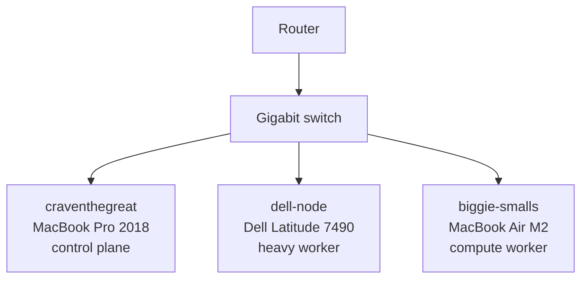

# homelab-kubecraft


The KubeCraft course, run on real hardware. A three-node k3s cluster on laptops I already owned, managed entirely from this repo with Flux. A `git push` is the deploy.

It's also my DevOps portfolio. Every app here is real, has a blog post behind it, and has broken at least once.

Portfolio: [projectpattie.com/kubecraft](https://projectpattie.com/kubecraft) · Build log: [projectpattie.com](https://projectpattie.com) · Sister repo: [`homelab-brasil`](https://github.com/CravenCraven/homelab-brasil)

---

## Contents

- [Why this exists](#why-this-exists)
- [Cluster](#cluster)
- [What's running](#whats-running)
- [Stack](#stack)
- [How a change gets deployed](#how-a-change-gets-deployed)
- [Design decisions](#design-decisions)
- [Repo layout](#repo-layout)
- [Getting started](#getting-started)
- [Operations](#operations)
- [Security](#security)
- [Roadmap](#roadmap)
- [Write-ups](#write-ups)

---

## Why this exists

I'm a sysadmin moving into DevOps. Reading about GitOps is not the same as having Flux delete your app because you removed a file. This repo is where the KubeCraft course meets a cluster I can break.

The rule: **nothing gets applied by hand.** If it isn't in `main`, it isn't in the cluster.

---

## Cluster

Three laptops that were in a drawer. None of them broken, just no longer getting updates.

| Node | Machine | Role | Arch | OS | Label |
|---|---|---|---|---|---|
| `craventhegreat` | MacBook Pro 2018 (T2), 16 GB RAM | Control plane | amd64 | Ubuntu Server, headless | `workload=light` |
| `dell-node` | Dell Latitude 7490, 32 GB RAM | Heavy worker | amd64 | Fedora | `workload=heavy` |
| `biggie-smalls` | MacBook Air M2, 16 GB RAM | Compute worker | arm64 | Fedora Asahi Remix | `workload=compute` |

Labels describe what a node can do, not what it is. When a node dies, the workload follows the label to whatever replaces it.



---

## What's running

| App | Namespace | What it does | Storage | Public |
|---|---|---|---|---|
| Linkding | `linkding` | Bookmark manager | 1 Gi PVC | Yes, through the tunnel |
| Mealie | `mealie` | Recipe manager | PVC | No |
| ntfy | `ntfy` | Push notifications to my phone | PVC | No |
| Homepage | `homepage` | Dashboard of everything on the cluster | ConfigMap | No |
| LittleLink | `littlelink` | Link-in-bio page | none | No |
| cloudflared | `cloudflared` | Outbound tunnel to Cloudflare | none | It *is* the door |
| kube-prometheus-stack | `monitoring` | Prometheus, Grafana, alert rules | PVC | No |

Audiobookshelf was the KubeCraft capstone ([write-up](https://projectpattie.com/blog/kubecraft-capstone-audiobookshelf)). Four PVCs, non-root, public through the tunnel, data survived a pod delete.

---

## Stack

### Running today

| Tool | Job | Since |
|---|---|---|
| k3s | Kubernetes on bare metal, flannel VXLAN networking | Aug 2026 |
| Flux | GitOps, pulls this repo and applies it, prunes drift | Aug 2026 |
| Kustomize | Base + staging overlays, built into Flux | Sep 2026 |
| Helm (via Flux `HelmRelease`) | kube-prometheus-stack, chart-generated Ingress | Sep 2026 |
| SOPS + age | Encrypted secrets committed to Git, decrypted by Flux | Oct 2026 |
| Traefik | Ingress, ships with k3s | Oct 2026 |
| Cloudflare Tunnel | Public exposure with zero inbound ports | Oct 2026 |
| local-path | Storage, ships with k3s | Sep 2026 |
| kube-prometheus-stack | Prometheus, Grafana, alerting | Sep 2026 |

### Planned

| Tool | Job | Why it's next |
|---|---|---|
| Grafana dashboard of my own | Node health, SLO, error budget | Imported dashboards show everything and explain nothing |
| cert-manager + Let's Encrypt | Real certificates | The Grafana ingress is on a self-signed cert today |
| Loki + Alloy | Cluster-wide log search | Prometheus says *that* something broke; logs say *why* |
| Cilium | CNI + LoadBalancer IPAM | Homelab Advanced track of the course |
| CloudNativePG | Postgres with backups and a tested restore | n8n needs a database, and I need a restore I've actually run |
| Terraform | Cloud infrastructure as code | AKS first, AWS after |

---

## How a change gets deployed


Flux itself is bootstrapped from [`homelab-brasil`](https://github.com/CravenCraven/homelab-brasil). That Flux instance watches this repo as a second `GitRepository` source (`flux-system-kubecraft`), through `clusters/dev/apps.yaml` and `clusters/dev/monitoring.yaml`. Course work and Brasil share the cluster but not the repo.

`prune: true` is on. Delete a file and Flux deletes the workload. That is the point, and it is also how you lose an app at 2 a.m. if you forget.

---

## Design decisions

Each one links to the post where I made it.

| Decision | Why | Trade-off |
|---|---|---|
| **Flux, not `kubectl apply`** ([post](https://projectpattie.com/blog/setting-up-gitops-with-flux)) | The manifests lived in my shell history and in my head, two places I do not trust | `prune: true` deletes your workload the moment you delete a file |
| **Cloudflare Tunnel, not open ports** ([post](https://projectpattie.com/blog/letting-linkding-out-of-the-house)) | I did not want to open a port and start advertising my front door. The router never accepts an inbound connection | Universal SSL covers one subdomain level, so hostnames had to be flattened |
| **Node labels, not node names** ([post](https://projectpattie.com/blog/not-ready-a-love-story)) | When `dell-node` dies, every workload asking for `workload=heavy` follows the label. Also, `dell-node` felt ugly in a YAML file | One more thing to set when joining a node |
| **`strategy: Recreate` for single-volume apps** ([post](https://projectpattie.com/blog/adding-persistent-storage-to-linkding)) | A rolling update deadlocks: the new pod can't mount a volume the old pod still holds | A few seconds of downtime on each deploy |
| **Chart-generated Ingress, not hand-written** ([post](https://projectpattie.com/blog/exercise-ingress-with-traefik)) | I do not edit a chart. I give it values. The chart owns the Ingress, so an upgrade doesn't fight my copy | A wrong value name doesn't fail. It just gets ignored |
| **SOPS + age for secrets** ([post](https://projectpattie.com/blog/exercise-ingress-with-traefik)) | A plaintext password in `values` ends up in Git history forever | Lose the age key and every secret in the repo is unreadable |
| **local-path storage, for now** ([post](https://projectpattie.com/blog/letting-linkding-out-of-the-house)) | Default in k3s, fast, free | Pinned to one node. Three nodes give that app no resilience at all |

---

## Repo layout

```
clusters/
└── dev/
    ├── apps.yaml                 # Flux Kustomization → apps/staging (SOPS decryption on)
    └── monitoring.yaml           # Flux Kustomization → infrastructure/monitoring/controllers/staging
apps/
├── base/                         # one folder per app: namespace, deployment, service, storage, secret
│   ├── cloudflared/
│   ├── homepage/
│   ├── linkding/
│   ├── littlelink/
│   ├── mealie/
│   └── ntfy/
└── staging/                      # what Flux actually applies
    ├── kustomization.yaml        # lists the base apps
    └── linkding/                 # staging-only patches (ingress)
infrastructure/
└── monitoring/
    └── controllers/
        ├── base/kube-prometheus-stack/     # HelmRepository + HelmRelease
        └── staging/kube-prometheus-stack/  # values and the SOPS-encrypted Grafana secret
docs/
└── runbooks/                     # what to do when it breaks
.sops.yaml                        # which age key encrypts secrets
```

Base holds the app as written. Staging holds the patches for this cluster. Flux only watches staging.

---

## Getting started

### Prerequisites

- `kubectl` with a kubeconfig for the cluster (context `homelab`)
- [`flux` CLI](https://fluxcd.io/flux/installation/)
- `sops` and `age`, plus the age private key (never in Git)

### Check the cluster

```bash
kubectl get nodes -L workload
flux get sources git -A
flux get kustomizations -A
kubectl get pods -A -o wide
```

### Deploy a change

```bash
git add <file>
git commit -m "feat(linkding): <what changed>"
git push origin main
flux reconcile kustomization apps --with-source   # optional, skips the wait
```

### Add a secret

```bash
kubectl create secret generic <name> -n <ns> --from-literal=key=value --dry-run=client -o yaml > secret.yaml
sops --encrypt --in-place secret.yaml
git add secret.yaml
```

`.sops.yaml` picks the key. Never commit a plaintext `Secret`.

### Point Flux at this repo (already done; here for the rebuild)

1. Bootstrap Flux from `homelab-brasil` (see that repo's README).
2. Create the `sops-age` secret in `flux-system` from the age private key.
3. Add a `GitRepository` named `flux-system-kubecraft` for this repo and apply `clusters/dev/*.yaml`.

---

## Operations

### If a node goes down

| Node | What stops | What to do |
|---|---|---|
| `craventhegreat` | The API. Running pods keep going, nothing new gets scheduled | Bring it back. It's the only control plane |
| `dell-node` | Anything with a `local-path` volume on it | Its volumes wait for it. Nothing moves elsewhere |
| `biggie-smalls` | Pods labeled `workload=compute`, and any volume pinned here | Wake it up. See the runbook below; this one has happened |

### Runbooks

- [App unreachable, node NotReady](docs/runbooks/app-unreachable-node-not-ready.md): the seven-hour outage that turned out to be a laptop going to sleep
- [Expose an app with Cloudflare Tunnel](docs/runbooks/expose-an-app-with-cloudflare-tunnel.md)

### Backups

**Current state: none.** Volumes live on one node's disk. A tested restore is on the roadmap, and it's the item I'm least proud of.

### Known issues

| Issue | Impact | Fix |
|---|---|---|
| Grafana ingress uses a self-signed certificate | Browser warning | cert-manager |
| Single control plane | No HA | Accepted for a homelab |
| Linkding volume pinned to one node | Node sleeps, app sleeps | Sleep disabled on every node; shared storage later |

---

## Security

| Area | Today | Planned |
|---|---|---|
| Secrets | SOPS + age. Encrypted in Git, decrypted by Flux at apply time | Rotate the age key, document the procedure |
| Exposure | Cloudflare Tunnel only. Zero inbound ports on the router | Each public app behind a login |
| TLS | Cloudflare edge for public apps; self-signed for Grafana | cert-manager + Let's Encrypt |
| Cluster access | kubeconfig on my Mac, SSH keys to each node | |
| Git access | Flux reads over HTTPS | Deploy key |
| Workloads | Pinned image tags; Audiobookshelf ran non-root | Non-root, read-only filesystems, dropped capabilities, limits on every app |
| Login | Each app has its own | Authentik SSO |

---

## Roadmap

The full 20-goal roadmap with every item's status is on the [portfolio page](https://projectpattie.com/kubecraft#roadmap). 24 of 97 done.

**Now**
- [ ] My own Grafana dashboard
- [ ] Alert rules in Prometheus, delivered to ntfy
- [ ] Runbook for every alert

**Next**
- [ ] cert-manager + Let's Encrypt
- [ ] An SLO for one app, with the error budget in Grafana
- [ ] Loki + Alloy
- [ ] Mixed-architecture scheduling with node affinity
- [ ] Cluster upgrade, one node at a time, written up

**Later**
- [ ] Cilium + LoadBalancer IPAM, External DNS
- [ ] CloudNativePG with a backup I've actually restored
- [ ] Terraform + AKS, then the first AWS project
- [ ] CI/CD with GitHub Actions, Trivy, automated image updates
- [ ] Authentik SSO

---

## Write-ups

Posts about building this cluster, on [projectpattie.com](https://projectpattie.com), in build order:

- [Setting Up GitOps with Flux](https://projectpattie.com/blog/setting-up-gitops-with-flux)
- [Joining the Dell as a k3s worker node](https://projectpattie.com/blog/joining-the-dell-as-a-k3s-worker-node)
- [The M2 Air as a homelab node](https://projectpattie.com/blog/the-m2-air-as-a-homelab-node)
- [Fedora Asahi Remix on Apple Silicon: A Runbook](https://projectpattie.com/blog/fedora-asahi-on-an-m2)
- [NotReady: A Love Story](https://projectpattie.com/blog/not-ready-a-love-story)
- [Where Does the Grafana Password Actually Come From?](https://projectpattie.com/blog/where-does-the-grafana-password-come-from)
- [Why Didn't My PVC Show Up in the Cluster?](https://projectpattie.com/blog/adding-persistent-storage-to-linkding)
- [Letting Linkding Out of the House](https://projectpattie.com/blog/letting-linkding-out-of-the-house)
- [Exercise: Ingress with Traefik](https://projectpattie.com/blog/exercise-ingress-with-traefik)
- [KubeCraft Capstone: Audiobookshelf with nothing but git](https://projectpattie.com/blog/kubecraft-capstone-audiobookshelf)
