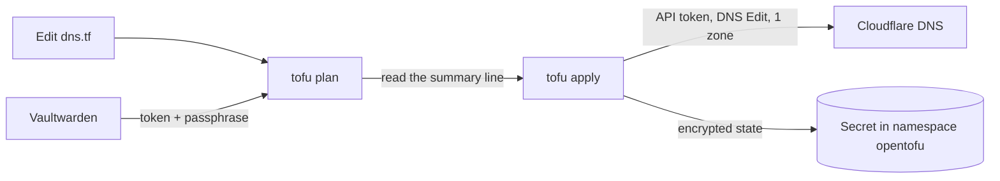

# opentofu


Cloudflare DNS for homelab-kubecraft, as code. Flux owns everything inside the cluster. This folder owns the one thing outside it the cluster can't work without: the records that send `*.projectpattie.com` to the tunnel.

Build log: [docs/runbooks/opentofu.md](../docs/runbooks/opentofu.md) · Parent repo: [homelab-kubecraft](../README.md)

---

## Contents

- [Why this exists](#why-this-exists)
- [Scope](#scope)
- [How a change gets applied](#how-a-change-gets-applied)
- [Design decisions](#design-decisions)
- [Folder layout](#folder-layout)
- [Getting started](#getting-started)
- [Operations](#operations)
- [Security](#security)
- [Roadmap](#roadmap)
- [Write-ups](#write-ups)

---

## Why this exists

Every app in this repo is in Git. Every DNS record that makes those apps public was not. I made each one by hand with `cloudflared tunnel route dns`, and the only place they were written down was the Cloudflare dashboard.

The rule for the cluster is **nothing gets applied by hand.** This folder extends that rule to DNS.

---

## Scope

17 records in the `projectpattie.com` zone. Nothing else in the zone is touched.

| Group | Type | Points at | Proxied | Hosts |
|---|---|---|---|---|
| Tunnel | CNAME | `<tunnel-id>.cfargotunnel.com` | Yes | abs, auth, feeds, home, links, me, mealie, n8n, ntfy, paperless, pgadmin, up, uptime, vault, zentao |
| Local-only | A | `var.node_ip` (10.0.0.106) | No | grafana, lds |

Left out on purpose:

| Record | Why |
|---|---|
| `projectpattie.com`, `www` | The blog on Cloudflare Pages. A bad apply here takes the site down |
| MX, SPF | Email forwarding. Same reason |
| `musica` | Different tunnel. Belongs to [`homelab-brasil`](https://github.com/CravenCraven/homelab-brasil) |
| `links.lab` | Leftover from old naming. Cleanup pending |

---

## How a change gets applied



This is the one part of the repo Flux doesn't touch. Flux only reads the paths in `clusters/dev/`, and `opentofu/` isn't one of them. A `git push` here stores the code and applies nothing. Cloudflare only changes when I run `tofu apply`.

That also means drift doesn't fix itself. Flux would put a hand edit back on its own. OpenTofu only tells me when I run `plan`.

---

## Design decisions

The reasoning and the commands behind each one are in the [runbook](../docs/runbooks/opentofu.md#28-decisions).

| Decision | Why | Trade-off |
|---|---|---|
| **State in a Kubernetes Secret** | Any machine with cluster access shares one state. The lock is a Lease, so two applies can't race | Cluster down means no plan or apply. DNS itself keeps working |
| **State encrypted client-side** (pbkdf2 + aes_gcm, `enforced = true`) | A Secret is only base64, and the state holds every record ID. Read access to the namespace still only gets ciphertext | Lose the passphrase and the state is unreadable |
| **`opentofu` namespace through Flux** | In Git like everything else, under `infrastructure/controllers/base/opentofu` | One more Kustomization to keep in mind |
| **No credentials in the repo** | Token and passphrase come from Vaultwarden as env vars. `terraform.tfvars` is gitignored, the `.example` shows its shape | Every new terminal needs the secrets loaded again |
| **Least-privilege token** | DNS Edit on one zone. A leaked token can't touch anything else in the account | A second zone means a second token or a wider one |
| **Import, not recreate** | The 17 records were already live. Adopting them with `import` blocks meant zero downtime | The import file is one-time and gets deleted after |
| **`for_each` over hostnames** | A new app is one more word. Records are keyed by name, so reordering the list never causes churn the way `count` would | Every record in a group has to look the same |
| **Versions pinned, lock file committed** | Same reason I pin image tags. Provider v4 to v5 renamed the DNS resource, so a major bump has to be on purpose | Upgrades are manual |
| **Part of the zone, not all of it** | OpenTofu only manages what's in its state. Blog and email can't be broken from here | Two sources of truth in one zone |

---

## Folder layout

```
opentofu/
├── versions.tf                 # OpenTofu + provider pins, empty provider block (auth from env)
├── backend.tf                  # kubernetes backend: namespace opentofu, context homelab
├── encryption.tf               # state passphrase variable + pbkdf2/aes_gcm, enforced
├── variables.tf                # zone_id, tunnel_id, node_ip
├── dns.tf                      # hostname sets + the two cloudflare_dns_record resources
├── terraform.tfvars.example    # shape of the gitignored terraform.tfvars
├── .terraform.lock.hcl         # exact provider version and checksums (committed)
└── .gitignore                  # state, tfvars, plans, crash logs, CLI config
```

---

## Getting started

### Prerequisites

- OpenTofu 1.11 or newer
- `kubectl` with a kubeconfig for the cluster (context `homelab`, in `~/.kube/config`)
- Bitwarden CLI logged in to `vault.projectpattie.com`, with items `opentofu-dns` and `opentofu-state-passphrase`
- `terraform.tfvars` copied from the example and filled in

### Load the secrets

```bash
export BW_SESSION=$(bw unlock --raw)
export CLOUDFLARE_API_TOKEN=$(bw get password opentofu-dns)
export TF_VAR_state_passphrase=$(bw get password opentofu-state-passphrase)
```

They only live in the terminal you set them in. `bw lock` when you're done.

### Check everything agrees

```bash
cd opentofu
tofu init
tofu plan
```

`No changes. Your infrastructure matches the configuration.` means Git, state and Cloudflare agree. Run `tofu` from inside this folder. Anywhere else gives `No configuration files`.

### Add a public app

1. Add the ingress rule in `apps/base/cloudflared/configmap.yaml`
2. Add the hostname to `tunnel_hosts` in `dns.tf`
3. `tofu plan`. Expect `1 to add, 0 to change, 0 to destroy`
4. `tofu apply`
5. Commit both files together

### Remove a record

Take the name out of `dns.tf`, run `tofu plan`, confirm it's `1 to destroy` and it's the right one, then apply.

To stop managing a record but keep it live:

```bash
tofu state rm 'cloudflare_dns_record.tunnel["<name>"]'
```

Then take the name out of `dns.tf`.

---

## Operations

### Rules

- **Never run `tofu destroy` here.** It deletes every managed record and takes every public app offline in one command
- **Read the plan summary before every apply.** Any destroy I didn't expect, I stop
- **Stuck lock.** If an apply dies mid-run the Lease can stay behind. Make sure nothing else is running, then `tofu force-unlock <lock-id>`

### If something breaks

| What happens | What stops | What to do |
|---|---|---|
| Someone edits a record in the dashboard | Nothing. It's drift | `tofu plan` shows it, `tofu apply` puts it back |
| State Secret deleted, or passphrase lost | Management only. Records keep resolving | Rebuild `imports.tf` from the API listing. Plan should say `17 to import, 0 to change` |
| API token leaked | Someone can edit DNS in this one zone | Roll the token in the dashboard, update `opentofu-dns` in Vaultwarden |
| Cluster down | Plan and apply | Wait for the cluster. Nothing here is on the request path |
| `craventhegreat` down | `grafana` and `lds` point at a dead IP | Bring it back. Local-only records are tied to one node |

### Known issues

| Issue | Impact | Fix |
|---|---|---|
| Hostname list lives in two places | `dns.tf` and the cloudflared ConfigMap drift if I update one | Generate one from the other, or a check that compares them |
| No CI | Drift only shows up when I run `plan` | `tofu plan` on every PR, scheduled plan for drift |
| Secret-loading helper is a shell function on one machine | Not in Git, not on my other machines | Move it into the repo or my dotfiles |
| Token never expires | A leak stays valid until I notice | Rotation schedule |

---

## Security

| Area | Today | Planned |
|---|---|---|
| Credentials | Env vars only, pulled from Vaultwarden. Nothing in the repo | Shared loader in Git |
| Token scope | DNS Edit, one zone, no IP filter (home IP changes) | Rotation schedule |
| State | Encrypted client-side, `enforced = true`, stored as a Secret | |
| State access | Anyone with Secret read in `opentofu` gets ciphertext only | RBAC on the namespace |
| Plain-text leftovers | Deleted the old `terraform.tfstate.backup` after encrypting | |
| Supply chain | Provider signed and pinned in `.terraform.lock.hcl` | |

---

## Roadmap

**Now**
- [ ] Clean up `links.lab`
- [ ] Get the secret loader into Git

**Next**
- [ ] `tofu plan` on every PR with GitHub Actions
- [ ] Scheduled plan that alerts to ntfy on drift
- [ ] One source of truth for hostnames

**Later**
- [ ] Token rotation, written up
- [ ] Same setup for `homelab-brasil` DNS

---

## Write-ups

- [Runbook: managing Cloudflare DNS with OpenTofu](../docs/runbooks/opentofu.md): every command in the order I ran it, the output, and the mistakes where they happened
